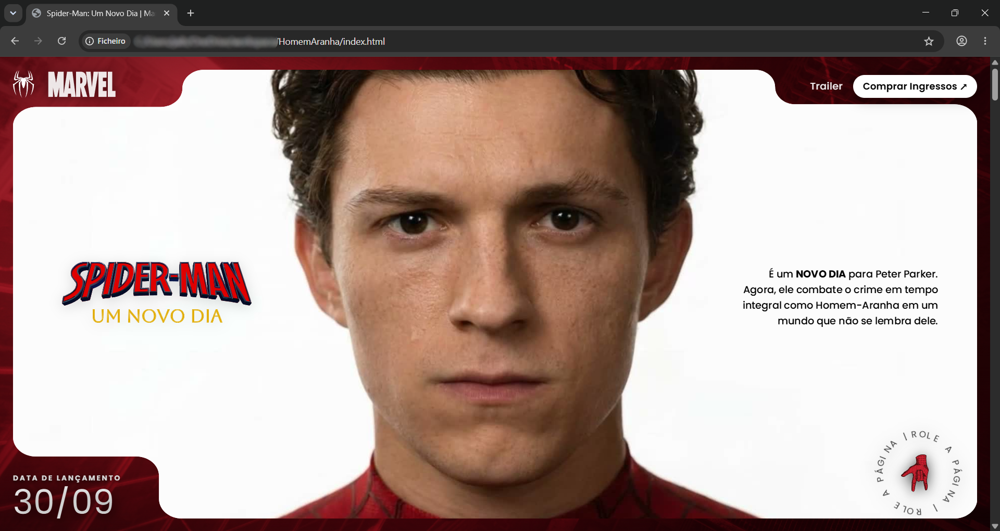
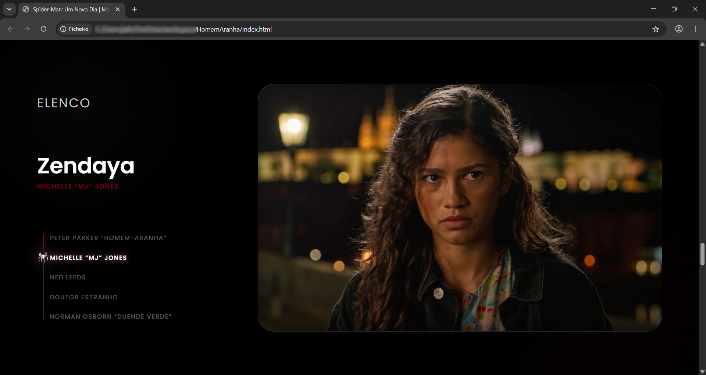

# 🕷️ Homem-Aranha Um Novo Dia

Landing page inspirada no universo cinematográfico do **Homem-Aranha Um Novo Dia**, desenvolvida no âmbito do projeto **DevArt 3.0**. O objetivo é criar uma experiência visual moderna e envolvente, combinando elementos gráficos, animações e conteúdos multimédia com auxilio da IA.

## 🛠️ Tecnologias e Ferramentas

- [**Figma**](https://www.figma.com/design/MUEjdmPRztkBeYZuckQADr/O-Homem-Aranha-with-DevArt?node-id=0-1&t=5ZnCcs42jWD02MVc-0) - design visual e protótipos.
- **HTML5** — estrutura e organização do conteúdo.
- **CSS3** — estilos, layout e apresentação visual.
- **JavaScript** — interatividade e comportamento dinâmico.
- **Antigravity IDE** — ambiente de desenvolvimento utilizado.

## ✨ Características

- Design visual inspirado no universo do Homem-Aranha.
- Elementos gráficos em SVG e imagens WebP.
- Conteúdos multimédia integrados.
- Recursos visuais relacionados com personagens e elenco.
- Apresentação de conteúdos através de uma landing page.

## 📂 Estrutura do Projeto

```text
.
├── assets/
│   ├── images/
│   │   ├── elenco/
│   │   └── frames/
│   └── video/
│       └── trailer.mp4
├── index.html
├── style.css
└── README.md
```

A pasta `assets/` reúne os recursos visuais e multimédia utilizados na página. A estrutura apresentada é resumida; os restantes ficheiros gráficos encontram-se nas respetivas subpastas.

## ▶️ Como Executar

1. Clonar o repositório:

   ```bash
   git clone git@github.com:JailsonVarela/DevArt-HomemAranha.git
   ```

2. Entrar na pasta do projeto:

   ```bash
   cd DevArt-HomemAranha
   ```

3. Abrir o ficheiro `index.html` num navegador Web.

4. Opcionalmente, utilizar a extensão **Live Server** no Visual Studio Code para executar a página durante o desenvolvimento.

Não é necessária uma instalação de dependências através de npm, desde que o projeto não utilize ferramentas adicionais além das indicadas.

## 🖼️ Demonstração





## 🎓 Contexto do Projeto

Projeto desenvolvido no contexto do **DevArt 3.0**, com foco no desenvolvimento frontend, na composição visual e na criação de uma experiência Web temática.

## 👤 Autor e Colaboradores

Jailson Varela

## 📄 Direitos de Autor e Créditos

Este projeto é de natureza educativa e demonstrativa. Os elementos gráficos, personagens, marcas e outros materiais utilizados foram fornecidos como materiais de apoio ao exercício. Os direitos de autor e demais direitos de propriedade intelectual sobre os materiais de terceiros pertencem aos respetivos titulares.

A utilização de materiais de terceiros não implica qualquer afiliação ou aprovação oficial por parte dos titulares desses direitos.
